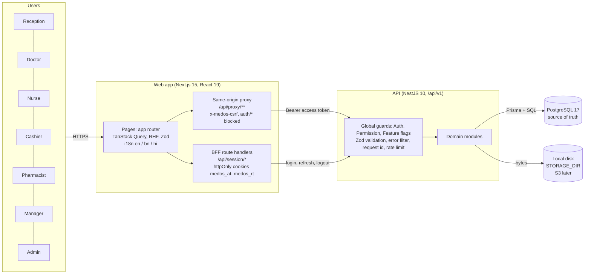
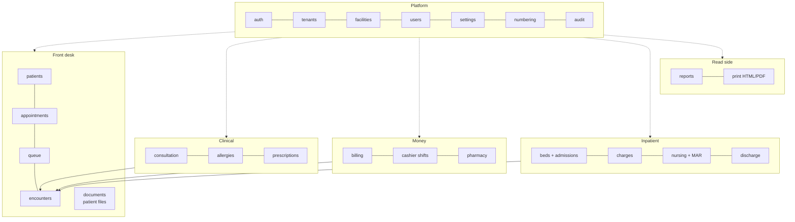
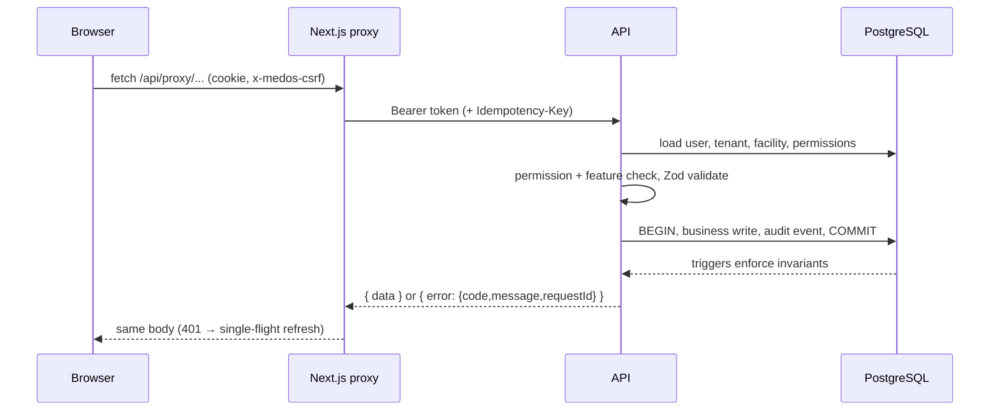
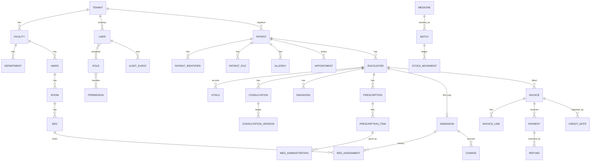
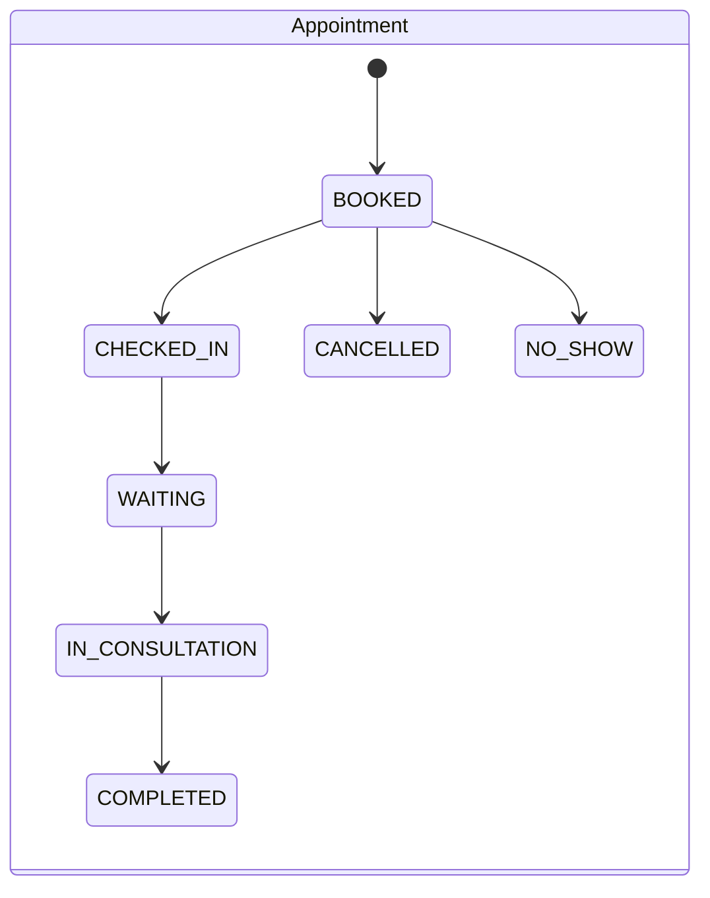
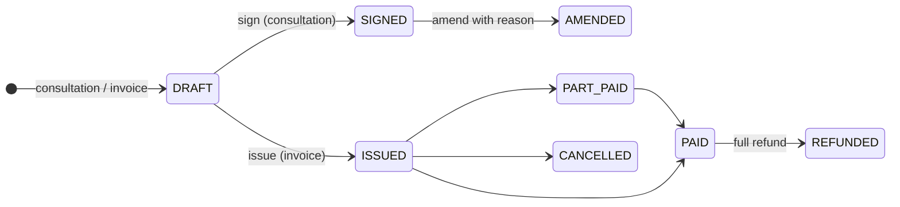
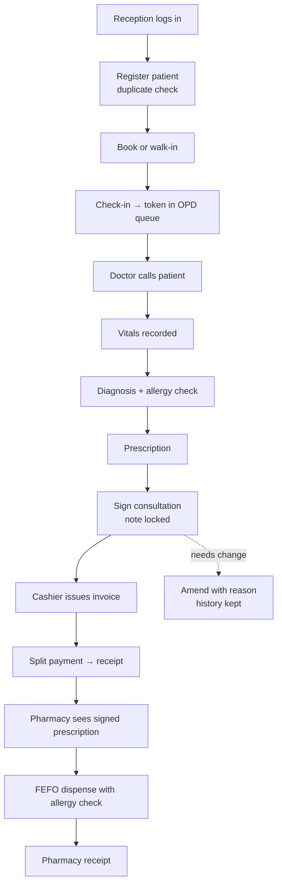
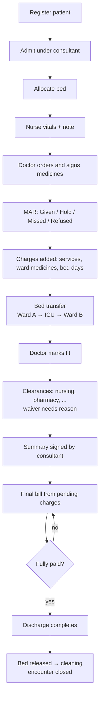
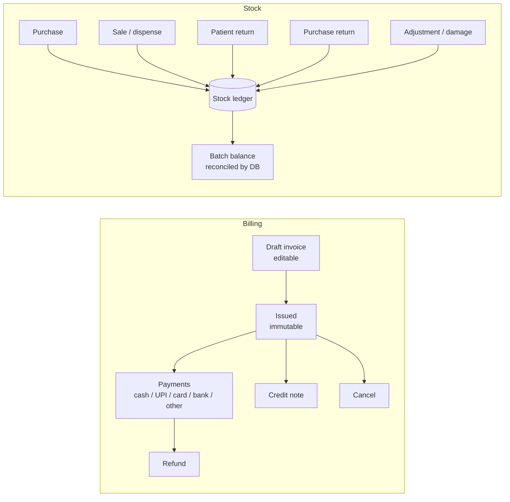

# MedOS MLP-1 — Design Document

Status: as built and verified on 2026-10-05. Mermaid diagrams render in VS Code (Markdown Preview Mermaid Support extension) and in `docs/architecture/diagrams.html` (open in any browser).

## 1. Purpose and scope
A multi-tenant Hospital Management System for small and medium Indian hospitals (10–150 beds, initially West Bengal). MLP-1 covers: authentication and RBAC, tenants and facilities, staff, patient registration, appointments, OPD queue and consultation, vitals, prescriptions, billing and payments, pharmacy, basic IPD, beds, basic nursing, discharge, core reports, audit trail, patient files, printing (HTML and PDF) and Bengali/Hindi UI.

Out of scope (see `docs/backlog.md`): AI, ABDM, Swasthya Sathi, LIMS, radiology, PACS, OT, insurance claims, payroll, HRMS, full accounting, patient app, telemedicine, advanced analytics.

## 2. Design principles
1. Patient safety, tenant security, financial integrity, data integrity, then speed (CLAUDE.md §60).
2. Tenant and facility come only from the authenticated session, never from the request.
3. Permissions, not role names, decide access. Re-read from the database on every request.
4. Signed clinical content and issued financial documents are never overwritten: amend, credit note, refund or reversal instead.
5. Integrity is enforced twice: in services and again in PostgreSQL (triggers, exclusion constraints, deferred reconciliation).
6. Every important mutation writes an audit event in the same transaction.
7. Configuration over customisation: feature flags, numbering, print templates, settings per facility.

## 3. Architecture

### 3.1 System context and containers

### 3.2 API module map (modular monolith)

Every clinical record references an Encounter (OPD or IPD). All modules share one canonical Patient.

### 3.3 Request pipeline

### 3.4 Deployment view (target; not yet run)
Local development: pnpm + turbo, local PostgreSQL 17 on 127.0.0.1:54329, API :4000, web :3000. Container images and compose stack exist but have never been built (REMINDER.md). Production needs HTTPS, secrets manager, managed PostgreSQL with PITR, S3 storage and a shared rate limiter.

## 4. Technology choices
| Area | Choice | Note |
|---|---|---|
| Web | Next.js 15, React 19, Tailwind 3, TanStack Query, React Hook Form, Zod | Hand-written UI components instead of shadcn (ADR-009) |
| API | NestJS 10, Prisma 6, zod strict schemas | |
| Database | PostgreSQL 17 | Hand-written SQL migrations carry domain rules |
| Auth | scrypt hashes, 15 min JWT access, opaque rotating refresh tokens | Argon2id deferred |
| Files | local disk behind `StorageService` | S3 driver deferred |
| PDF | pdfkit (MIT) | Latin fonts only for now |
| Tests | tsc, node:test + supertest on a real DB, Playwright (Chromium) | Jest/Vitest blocked by antivirus |

## 5. Security design
- **Tenant isolation:** every query is tenant-scoped; composite foreign keys; an id-sweep test hits every id route with another tenant's ids. PostgreSQL RLS is deferred (REMINDER.md).
- **Session:** tokens never reach browser JavaScript; httpOnly SameSite cookies; CSRF header on mutations; refresh-token reuse revokes the family; lockout after repeated failures.
- **Authorization:** permission-based RBAC (single source `packages/shared/src/permissions.ts`); UI hides, API decides.
- **Input:** strict zod schemas reject unknown fields; uploads validated by magic bytes; CSV export neutralises formula injection; print HTML is fully escaped with a locked-down CSP.
- **Logging:** structured, request id, no tokens, passwords or clinical payloads.

## 6. Data model (summary)

## 7. Key business rules and where they are enforced
| Rule | Service | Database |
|---|---|---|
| One canonical patient; duplicates detected, never auto-merged | patients | trigram index |
| No double booking | appointments | exclusion constraint |
| One active admission per patient; a bed holds one admission | ipd | partial unique + exclusion |
| Signed consultation is immutable; amendments keep versions | consultation | immutability trigger |
| Vitals, notes, audit are append-only | respective services | append-only triggers |
| Issued invoice never changes; totals server-side decimal | billing | reconciliation checks (deferred) |
| Overpayment rejected; split payments | billing | check constraints |
| Stock ledger is truth; FEFO; no expired batch; no oversell | pharmacy | row locks, balance reconciles to ledger |
| Order ≠ administration | nursing | separate table |
| Discharge needs fitness, clearances, signed summary and paid final bill | discharge | state trigger |
| Patient files immutable except ACTIVE → REMOVED | documents | trigger |
| Idempotency on payments, refunds, dispensing, purchases, adjustments | idempotency store | unique key |

## 8. State machines

Bed status: AVAILABLE → OCCUPIED → CLEANING → AVAILABLE (also RESERVED, MAINTENANCE).

## 9. Business flow diagrams

### 9.1 OPD (mandatory workflow, CLAUDE.md §36)

### 9.2 IPD (mandatory workflow, CLAUDE.md §37)

### 9.3 Money and stock

## 10. Roles and permission bundles
| Role | Primary purpose | Key permissions |
|---|---|---|
| Receptionist | Registration, booking, queue, admission, draft invoices | PATIENT_*, APPOINTMENT_*, QUEUE_*, ADMISSION_READ/CREATE/TRANSFER, INVOICE_READ/CREATE, DUPLICATE_OVERRIDE |
| Doctor | Consultation, orders, discharge | CONSULTATION_*, VITALS_*, ALLERGY_WRITE, PRESCRIPTION_*, ADMISSION_DISCHARGE |
| Nurse | Ward care, MAR | NURSING_*, VITALS_*, ADMISSION_TRANSFER |
| Cashier | Invoices, payments, refunds, shifts | INVOICE_ISSUE, PAYMENT_CREATE/REFUND, CASHIER_SHIFT_MANAGE |
| Pharmacist | Dispense, stock, purchases | PHARMACY_*, INVOICE_ISSUE, PAYMENT_CREATE, REPORT_READ |
| Manager | Oversight | REPORT_READ, INVOICE_DISCOUNT/CANCEL/ADJUST, AUDIT_READ |
| Administrator | Setup and audit | ADMIN_USERS/MASTERS/SETTINGS, AUDIT_READ, REPORT_READ and more |
Custom roles are supported by the API. Exact lists: `packages/shared/src/permissions.ts`.

## 11. Non-functional design
- **Performance:** paginated lists, trigram and composite indexes, no N+1. Measured on one machine with 30,000 patients and 60,000 audit events: searches and lookups within budget.
- **Concurrency:** SKIP LOCKED queue calls, row locks for stock and beds, advisory locks and atomic upserts for numbering, exclusion constraints for booking.
- **Time and money:** timestamps in UTC, shown in Asia/Kolkata; money is NUMERIC / decimal.js, never floats; Latin digits in all languages.
- **Backup:** logical dump and verified restore scripts (`scripts/backup.ps1`, `restore-test.ps1`); PITR and encryption deferred.

## 12. Known limitations
See `docs/certification.md` §5 and `REMINDER.md`. Summary: Docker/CI never run; no RLS; per-instance rate limiting; no PITR/encryption; Latin-only PDF fonts; translations unreviewed; no external clinical, tax, data-protection or penetration review.
